# Multi-Agent Coding Assistant (MACA)

> [!WARNING]
> **MACA is currently in active development and is in the ALPHA stage.**
You may encounter bugs, breaking changes, or unfinished features.

MACA is a **local-first, hybrid AI coding assistant** that routes work by complexity and coordinates planning, coding, and review agents directly in your workspace.

> **Why it matters:** simple tasks stay on your machine, while more demanding work can use powerful cloud models only when they are truly needed.

## ✨ What Makes MACA Different

- **Local-first by design:** keep routine work private, fast, and free from token billing.
- **Hybrid routing:** use local models for simple tasks and stronger cloud models for harder reasoning.
- **Agentic workflow:** planner, coder, and reviewer agents collaborate to improve the final result.

## 🚀 Core Features

- **Smart task routing:** analyzes each request and sends it to the best backend for the job.
  - **Simple tasks:** local Gemma (`gemma2:2b`) via Ollama.
  - **Medium complexity tasks:** Google Gemini (`gemini-3.5-flash`) via REST API. If Gemini is offline/unconfigured, falls back to Anthropic Claude, then local Gemma.
  - **Complex / Very Complex tasks:** Anthropic Claude (default `claude-opus-4-8` or custom model) via Messages API. If Claude is offline/unconfigured, falls back to Google Gemini, then local Gemma.
- **7-Agent autonomous orchestration:** specialized agents collaborate through a staged pipeline coordinated by the Orchestrator.
  - **Task Classifier Agent:** evaluates task complexity (`SIMPLE`, `MEDIUM`, `COMPLEX`, `VERY_COMPLEX`).
  - **Clarifier Agent:** dynamically analyzes greenfield framework requests (Spring Boot, Next.js, React, FastAPI, etc.) and elicits architectural choices (build tool, runtime version, language).
  - **Planner Agent:** inspects the codebase and creates a structured implementation plan.
  - **Spec Agent:** drafts formal technical specifications for complex tasks and manages human approval checkpoints.
  - **Coder Agent:** implements modular, typed code (`SimpleCoder` / `SpecCoder`) strictly adhering to language and framework standards.
  - **Code Completion Verifier Agent:** checks generated files against specifications in an iterative completion loop.
  - **Reviewer Agent:** audits code with line-level diff blocks for logic, syntax, and safety, looping with corrections until approved.
- **Auto-apply workflow:** updates your files directly in the current workspace.
- **Task isolation & todo tracking:** tracks step-by-step progress and continuation state inside `.maca/<task>/`.
- **Robust fallbacks:** handles blocked Ollama ports, offline/mock mode, and terminal output fallback paths without breaking the experience.

---

## 🏗️ Architecture

```mermaid
flowchart TD
    User(["User Prompt"]) --> Intent["0. IntentClassifier\n(CONTINUE vs NEW_TASK)"]

    %% Continue Flow (bypasses complexity classification)
    Intent -->|"CONTINUE"| TaskStore["TaskStore (.maca/tasks.json)\nLookup recent tasks by timestamp"]
    TaskStore --> ConfirmContinue{"User Confirmation /\nRecent Task Disambiguation"}
    ConfirmContinue -->|"Confirmed"| ResumeOrch["Orchestrator: resume_task()\n(Reuse saved complexity, plan & spec)"]
    ConfirmContinue -->|"Cancelled / None"| ContinueAbort(["Continue Aborted"])
    ResumeOrch --> Orch2

    Intent -->|"NEW_TASK"| Orch1["1. Orchestrator: Init TaskContext & Allowed Directory"]

    %% Step 1: Task Classification
    subgraph Step1 ["Step 1: Task Classification & Clarification"]
        Orch1 --> Classifier["TaskClassifierAgent"]
        Classifier -->|"Complexity: SIMPLE / MEDIUM / COMPLEX / VERY_COMPLEX"| Orch2["Orchestrator: Model Selection"]
        Classifier -.->|"Create & update task record\n(timestamp, stage, status)"| TaskStore
        Orch2 --> ClarifierAgentNode["ClarifierAgent\n(LLM Stack Detection & Clarification)"]
        ClarifierAgentNode -->|"Bootstrap Config Injected"| Planner["PlannerAgent"]
    end

    %% Step 2: Implementation Planning
    subgraph Step2 ["Step 2: Implementation Planning"]
        Planner -->|"Implementation Plan & .todo"| PlanDoc[".maca/<task>/plan.md"]
        PlanDoc --> ComplexityCheck{"Task Complexity?"}
    end

    %% Step 3: Spec & Human Approval
    subgraph Step3 ["Step 3: Specification & Human Approval"]
        ComplexityCheck -->|"MEDIUM / COMPLEX / VERY_COMPLEX"| Spec["SpecAgent"]
        Spec -->|"Technical Specification & .todo"| SpecDoc[".maca/<task>/spec.md"]
        SpecDoc --> HumanApproval{"Human Spec Review\n(Approve or /cancel)"}
        HumanApproval -->|"Approved"| Orch3["Orchestrator: Proceed to Implementation"]
        HumanApproval -->|"'/cancel'"| Abort(["Task Aborted by User"])
        ComplexityCheck -->|"SIMPLE"| Orch3
    end

    %% Step 4: In-Memory Code Implementation & Incremental Staging
    subgraph Step4 ["Step 4: Code Implementation & Incremental Staging"]
        Orch3 --> Coder["CoderAgent (SimpleCoder / SpecCoder)"]
        Coder -->|"Generates files & flushes\nincrementally to staging"| StagedFiles["Staged Files Disk Checkpoint\n(.maca/<task>/staging/)"]
    end

    %% Step 5: Code Completion Loop
    subgraph Step5 ["Step 5: Code Completion Verification Loop (max 10 iterations)"]
        StagedFiles --> Verifier["CodeCompletionVerifierAgent"]
        Verifier --> VerifierDecision{"All Plan Steps\nCompleted?"}
        VerifierDecision -->|"NO: Missing steps"| NudgeVerifier["Orchestrator Nudge:\nResume from .todo pending items"]
        NudgeVerifier -->|"Flush incremental updates to staging"| Coder
    end

    %% Step 6: Pre-Review Staging Persistence
    subgraph Step6 ["Step 6: Pre-Review Staging Persistence (Workspace Clean)"]
        VerifierDecision -->|"YES: Complete"| PreReview["WorkspaceManager: flush_to_staging\n& record metadata (.maca/<task>/progress.md)"]
        PreReview --> DiskStaging[("Staged Files on Disk\n(.maca/<task>/staging/)")]
    end

    %% Step 7: Review Audit Loop
    subgraph Step7 ["Step 7: Reviewer Audit & Correction Loop (max 10 iterations)"]
        DiskStaging --> Reviewer["ReviewerAgent\n(Audits staged files & line diffs)"]
        Reviewer --> ReviewerDecision{"Review Decision:\nClean Code & Correct?"}
        ReviewerDecision -->|"REVISIONS REQUESTED"| NudgeReviewer["Orchestrator Nudge:\nPass Reviewer feedback & file blocks"]
        NudgeReviewer -->|"Flush corrections to staging"| Coder
    end

    %% Step 8: Post-Review Promotion & Final Completion
    subgraph Step8 ["Step 8: Post-Review Workspace Promotion & Final Completion"]
        ReviewerDecision -->|"APPROVED"| Promote["WorkspaceManager: promote_staging_files\n(Applies staged files to workspace repository)"]
        Promote --> FinalWrite["WorkspaceManager:\nRecord final task completion & updates"]
        FinalWrite --> Done(["Task Completed Successfully!"])
    end
```



> For an in-depth breakdown of the multi-agent design, JSON-RPC 2.0 communication over persistent stdio, and architectural invariants, see [docs/architecture.md](docs/architecture.md).

### 1. How Task Routing Works

MACA evaluates task complexity before selecting a model to execute the coding assignment:
- **Complexity Assessment**:
  - The **Task Router** queries the local Gemma model (gemma2:2b via Ollama) to analyze the user prompt and classify it into one of four categories: SIMPLE, MEDIUM, COMPLEX, or VERY_COMPLEX.
  - *Fallback Heuristic*: If Gemma/Ollama is offline, the router falls back to a regex-based keyword density and word count heuristic classifier to make a prediction.
- **Model Assignment & Fallbacks**:
  - **SIMPLE Tasks**: Handled entirely locally by the **Local Gemma Client** to minimize latency and token usage.
  - **MEDIUM Tasks**: Routed preferentially to **Gemini Client** (Flash/Pro) for rapid, intelligent processing. If Gemini is configured but offline, it falls back to **Claude Client** (or local Gemma if no remote APIs are online).
  - **COMPLEX or VERY_COMPLEX Tasks**: Routed preferentially to **Claude Client** (Opus/Sonnet) for advanced reasoning. If Claude is configured but offline, it falls back to **Gemini Client** (or local Gemma if necessary).

---

### 2. How Agents Collaborate

Once a model client has been assigned, the **Multi-Agent Orchestrator** manages the coding pipeline using a suite of dedicated, specialized agents:

1. **Task Classification & Clarification**:
   - **Task Classifier Agent**: Analyzes prompt complexity (`SIMPLE`, `MEDIUM`, `COMPLEX`, `VERY_COMPLEX`) to determine model routing and whether a formal specification is required.
   - **Clarifier Agent**: Analyzes greenfield project requests via LLM (Spring Boot, Spring Framework, Next.js, React, FastAPI, Django, etc.). It extracts parameters already provided in the prompt and interactively elicits critical architectural choices (build tool, runtime/Java version, language variant) with recommended modern LTS choices, falling back to deterministic defaults in non-interactive mode. The resolved configuration is tracked in `.maca/<task>/clarifier.todo` and injected into subsequent planning and coding stages.

2. **Planner Agent**:
   - Analyzes the task description, repository context, and bootstrap configuration.
   - Generates a structured Markdown implementation plan specifying files to create or modify.
   - Saves the plan to `.maca/<task>/plan.md` and tracks tasks in `.maca/<task>/planner.todo`.

3. **Complexity Routing & Spec Flow**:
   - **For SIMPLE Tasks**: Bypasses the specification phase entirely, routing the plan directly to the **Simple Coder Agent**.
   - **For MEDIUM / COMPLEX / VERY_COMPLEX Tasks**: Routes to the **Spec Agent** to draft a formal **Technical Specification** document at `.maca/<task>/spec.md`.
   - **Interactive User Review**: The CLI pauses execution, alerting the user that the specification is ready for review. You can open and edit `.maca/<task>/spec.md` to add constraints, then press Enter to approve or type `/cancel` to abort. Once approved, the task proceeds to the **Spec Coder Agent**.

4. **Coder Agents & Staged Disk Flushing**:
   - Implements code changes based on either the plan (`SimpleCoderAgent`) or technical specification (`SpecCoderAgent`) with strict language and framework fidelity (e.g. Maven/Gradle and Java 21 for Spring Boot; Vite and TypeScript for React; Python for Python).
   - Generates code files parsed via `[FILE: path]` blocks and immediately flushes them incrementally to `.maca/<task>/staging/` to avoid OOM memory bloat and checkpoint progress against process interruption.

5. **Code Completion Verification Loop**:
   - **Code Completion Verifier Agent** audits generated code against the specification to ensure all planned steps are complete.
   - If incomplete, it nudges the coder with feedback and remaining checklist items from `.maca/<task>/coder.todo` (up to 10 iterations). All incremental updates are written to staging disk.

6. **Pre-Review Staging Persistence (Clean Workspace Boundary)**:
   - Once the Code Completion Verifier confirms all planned steps are present, all generated files are staged in `.maca/<task>/staging/` (`flush_to_staging`).
   - The user's active workspace repository files remain clean and untouched before review. Stage progress and line-level block metadata are recorded under `.maca/<task>/progress.md` and `.maca/<task>/task.json`.

7. **Reviewer Agent & Correction Loop**:
   - **Reviewer Agent** audits the staged files using line-level diff blocks against the repository and clean code guidelines (modularity, single responsibility, typing, correctness).
   - If issues are detected, it outputs a detailed report and nudges the coder to apply corrections to the staged files. The loop repeats until approved (up to 10 attempts).

8. **Post-Review Workspace Promotion**:
   - Upon Reviewer `APPROVED`, `WorkspaceManager: promote_staging_files` atomically copies/promotes the approved files from `.maca/<task>/staging/` into the workspace repository root (enforcing path safety and dry-run sandbox rules).


## 🛠️ Setup Instructions

### 1. Install and run the CLI
Use the local launcher scripts under [local/scripts](local/scripts):
```sh
./local/scripts/install_mac.sh
./local/scripts/run_mac.sh
```

If you only need the Gemma/Ollama setup, use:
```sh
./local/scripts/setup_gemma.sh
```

### 2. Configure API Keys (Environment or macOS Keychain)
MACA uses Google Gemini and Anthropic Claude for medium and above tasks. For secure setup details, see [docs/keys_setup.md](docs/keys_setup.md).

* **Quick Env Setup**:
  ```bash
  export GEMINI_API_KEY="your-gemini-api-key"
  export CLAUDE_API_KEY="your-claude-api-key"
  ```

  You can optionally customize the models and request timeouts (in seconds):
  ```bash
  export GEMINI_MODEL="gemini-3.5-flash"
  export GEMINI_TIMEOUT_SECONDS="120"

  export CLAUDE_MODEL="claude-opus-4-8"
  export CLAUDE_TIMEOUT_SECONDS="120"
  ```
* **Recommended macOS Keychain + .zshenv Setup**:
  ```bash
  security add-generic-password -a "$USER" -s "MACA_GEMINI_API_KEY" -w "your-gemini-key"
  echo 'export GEMINI_API_KEY="$(security find-generic-password -a "$USER" -s "MACA_GEMINI_API_KEY" -w 2>/dev/null)"' >> ~/.zshenv
  source ~/.zshenv
  ```
  This keeps the secret in your Keychain and makes it available to MACA every time a new zsh session starts.

### 3. Run tests
```sh
PYTHONPATH=src python -m unittest discover -s tests -v
```

### 4. Development & Static Analysis
We enforce code quality and security checks on both local builds and CI pipelines:
- **Ruff**: Code linting and formatting (auto-runs on commit).
- **Mypy**: Strict type-checking.
- **Bandit**: Security scanning for potential vulnerabilities.

The `./local/scripts/install_mac.sh` launcher script handles setting these up automatically. It will:
1. Install all dependencies from `requirements-dev.txt`.
2. Install **pre-commit** hooks (`pre-commit install`) that auto-fix code style issues on commit.
3. Run Ruff, Mypy, and Bandit audits locally. If any check fails, the build script exits with a non-zero exit code.

You can also run analysis manually inside your virtual environment:
```sh
# Run linter checks
ruff check .
ruff format --check .

# Run type checker
mypy src

# Run security checks
bandit -c pyproject.toml -r src/

# Single full validation one-liner:
PYTHONPATH=src python -m unittest discover -s tests -v && ruff check . && ruff format --check . && mypy src && bandit -c pyproject.toml -r src/
```

---

## 💻 How to Use

### Run in Interactive REPL Mode
Launch the interactive console:
```sh
python3 -B src/maca/main.py
```

### Run a Single Command Task
Submit a task directly from your terminal:
```sh
maca "write a simple hello world script in output.py"
```

### Force a Specific Model
Override default task routing:
```sh
maca --model gemini "implement a custom tokenizer"
maca --model claude "implement a custom tokenizer"
```

### Run in Mock Mode (Simulated Run)
Test the orchestrator workflow without local models or API keys:
```sh
maca --mock "create an event logging class in python"
```

### Continue a Previous Task
MACA maintains a timestamped list of tasks per working directory in `.maca/tasks.json`. To resume a previous task without re-classifying the prompt for complexity, enter `continue` in the interactive REPL or from the CLI:
```sh
maca continue
```
- MACA identifies the `continue` intent directly via `IntentClassifier` and bypasses `TaskClassifierAgent`.
- If multiple recent tasks exist within a few minutes of each other (default: 5 minutes, configurable via `MACA_CONTINUE_WINDOW_MINUTES`), MACA displays them and asks you to confirm which task to resume.
- Once confirmed, `Orchestrator.resume_task()` takes over, reusing the recorded complexity and saved `.maca/<task>/plan.md` and `.maca/<task>/spec.md` artifacts when available.
