# Agent Architecture Overview

The **MACA** system is built around a single **Orchestrator** acting as the central coordinator for all agent-to-agent (A2A) interactions. Every agent has a single responsibility, and sub-agents never communicate directly with each other.

```mermaid
flowchart TD
    User(["User Prompt"]) --> Intent["0. IntentClassifier\n(CONTINUE vs NEW_TASK)"]

    %% Continue Flow (bypasses complexity classification)
    Intent -->|"CONTINUE"| TaskStore["TaskStore (.maca/tasks.json)\nLookup recent tasks by timestamp"]
    TaskStore --> ConfirmContinue{"User Confirmation /\nRecent Task Disambiguation"}
    ConfirmContinue -->|"Confirmed"| ResumeOrch["Orchestrator: resume_task()\n(Reuse saved complexity, plan & spec)"]
    ConfirmContinue -->|"Cancelled / None"| ContinueAbort(["Continue Aborted"])
    ResumeOrch --> Orch2

    Intent -->|"NEW_TASK"| Orch1["1. Orchestrator: Init TaskContext & Allowed Directory"]

    %% Step 1: Task Classification
    subgraph Step1 ["Step 1: Task Classification & Clarification"]
        Orch1 --> Classifier["TaskClassifierAgent"]
        Classifier -->|"Complexity: SIMPLE / MEDIUM / COMPLEX / VERY_COMPLEX"| Orch2["Orchestrator: Model Selection"]
        Classifier -.->|"Create & update task record\n(timestamp, stage, status)"| TaskStore
        Orch2 --> ClarifierAgentNode["ClarifierAgent\n(LLM Stack Detection & Clarification)"]
        ClarifierAgentNode -->|"Bootstrap Config Injected"| Planner["PlannerAgent"]
    end

    %% Step 2: Implementation Planning
    subgraph Step2 ["Step 2: Implementation Planning"]
        Planner -->|"Implementation Plan & .todo"| PlanDoc[".maca/<task>/plan.md"]
        PlanDoc --> ComplexityCheck{"Task Complexity?"}
    end

    %% Step 3: Spec & Human Approval
    subgraph Step3 ["Step 3: Specification & Human Approval"]
        ComplexityCheck -->|"MEDIUM / COMPLEX / VERY_COMPLEX"| Spec["SpecAgent"]
        Spec -->|"Technical Specification & .todo"| SpecDoc[".maca/<task>/spec.md"]
        SpecDoc --> HumanApproval{"Human Spec Review\n(Approve or /cancel)"}
        HumanApproval -->|"Approved"| Orch3["Orchestrator: Proceed to Implementation"]
        HumanApproval -->|"'/cancel'"| Abort(["Task Aborted by User"])
        ComplexityCheck -->|"SIMPLE"| Orch3
    end

    %% Step 4: In-Memory Code Implementation & Incremental Staging
    subgraph Step4 ["Step 4: Code Implementation & Incremental Staging"]
        Orch3 --> Coder["CoderAgent (SimpleCoder / SpecCoder)"]
        Coder -->|"Generates files & flushes\nincrementally to staging"| StagedFiles["Staged Files Disk Checkpoint\n(.maca/<task>/staging/)"]
    end

    %% Step 5: Code Completion Loop
    subgraph Step5 ["Step 5: Code Completion Verification Loop (max 10 iterations)"]
        StagedFiles --> Verifier["CodeCompletionVerifierAgent"]
        Verifier --> VerifierDecision{"All Plan Steps\nCompleted?"}
        VerifierDecision -->|"NO: Missing steps"| NudgeVerifier["Orchestrator Nudge:\nResume from .todo with delta file context"]
        NudgeVerifier -->|"Flush incremental updates to staging"| Coder
    end

    %% Step 6: Pre-Review Staging Persistence
    subgraph Step6 ["Step 6: Pre-Review Staging Persistence (Workspace Clean)"]
        VerifierDecision -->|"YES: Complete"| PreReview["WorkspaceManager: flush_to_staging\n& record metadata (.maca/<task>/progress.md)"]
        PreReview --> DiskStaging[("Staged Files on Disk\n(.maca/<task>/staging/)")]
    end

    %% Step 7: Review Audit Loop
    subgraph Step7 ["Step 7: Reviewer Audit & Correction Loop (max 10 iterations)"]
        DiskStaging --> Reviewer["ReviewerAgent\n(Audits staged files & line diffs)"]
        Reviewer --> ReviewerDecision{"Review Decision:\nClean Code & Correct?"}
        ReviewerDecision -->|"REVISIONS REQUESTED"| NudgeReviewer["Orchestrator Nudge:\nPass Reviewer feedback & delta file context"]
        NudgeReviewer -->|"Flush corrections to staging"| Coder
    end

    %% Step 8: Post-Review Promotion & Final Completion
    subgraph Step8 ["Step 8: Post-Review Workspace Promotion & Final Completion"]
        ReviewerDecision -->|"APPROVED"| Promote["WorkspaceManager: promote_staging_files\n(Applies staged files to workspace repository)"]
        Promote --> FinalWrite["WorkspaceManager:\nRecord final task completion & updates"]
        FinalWrite --> Done(["Task Completed Successfully!"])
    end
```



## Why the Orchestrator is the Central Coordinator
- **Single Point of Control** – The Orchestrator manages the execution lifecycle, routing state, and conversation history. Sub-agents remain decoupled from the workflow graph.
- **Process Isolation** – Sub-agents run via the `a2a_call_helper.call_agent` protocol over `stdin`/`stdout`, protecting the system from process crashes or memory leaks.
- **Single Responsibility** – Neither the Orchestrator nor the sub-agents handle responsibilities outside their scope. Specialized tasks such as code completion verification and workspace file operations are encapsulated in dedicated modules.
- **Pre-Review Staging Persistence & Line-Level Auditing** – Generated code output is flushed incrementally to `.maca/<task>/staging/` during coder and verification iterations. At Step 6, all files are staged and checkpointed with progress recorded in `.maca/<task>/task.json` and `.maca/<task>/progress.md`. The user's active workspace repository files remain clean and uncorrupted until review approval. The Reviewer Agent audits the staged files and modified file and line blocks to ensure targeted, high-precision review. Upon approval at Step 8, `promote_staging_files` safely applies the changes to the repository root.
- **Agent Task Progress & Continuation on Nudge** – Each agent records its ongoing progress in a dedicated todo checklist at `.maca/<task>/<agent>.todo`. When an agent is nudged by the Orchestrator with feedback, it reads its existing `.todo` file and continues remaining or revised items rather than restarting the entire task from scratch.

## Agent Responsibilities

| Agent / Service | Module | Responsibility |
| :--- | :--- | :--- |
| **Orchestrator** | `maca.orchestrator` | Central agent controlling the workflow, model selection, task resumption, and nudge loops. |
| **IntentClassifier** | `maca.intent` | Identifies `CONTINUE` vs `NEW_TASK` prompt intent prior to complexity classification. |
| **TaskStore** | `maca.task_store` | Maintains a timestamped list of tasks per working directory in `.maca/tasks.json` and resolves recent continuation candidates. |
| **TaskClassifierAgent** | `maca.agents.task_classifier` | Classifies task complexity (`SIMPLE`, `MEDIUM`, `COMPLEX`, `VERY_COMPLEX`). |
| **ClarifierAgent** | `maca.agents.clarifier` | Analyzes tasks via LLM to detect framework bootstrapping, extracts pre-specified parameters, and dynamically formulates architectural clarification questions. |
| **FrameworkBootstrapClarifier** | `maca.clarifier` | Deterministic rules and fallback heuristics for framework clarification when offline. |
| **PlannerAgent** | `maca.agents.planner` | Analyzes user request and repo files to generate an implementation plan. |
| **SpecAgent** | `maca.agents.spec` | Converts implementation plan into a formal technical specification for complex tasks. |
| **CoderAgent** | `maca.agents.coder` | Implements requested code changes based on plan or specification (`SimpleCoder` / `SpecCoder`). |
| **CodeCompletionVerifierAgent** | `maca.agents.code_completion_verifier` | Verifies whether all planned steps in the specification are fully implemented. |
| **ReviewerAgent** | `maca.agents.reviewer` | Audits code for clean code guidelines, bug safety, and gives approval or corrections. |
| **WorkspaceManager** | `maca.workspace` | Handles safe file reading, writing, and repository directory walking within sandbox boundaries. |
| **DeltaContext** | `maca.delta_context` | Builds delta-only file context (full content for referenced files, compact 1-line summaries for unchanged files) and targeted unified diffs for verifier and reviewer nudges. |
| **JsonRpcService** | `maca.jsonrpc` | Persistent JSON-RPC 2.0 agent worker and client managing stdio RPC communication. |
| **BackendHealthService** | `maca.health` | Probes local and remote model connectivity and API status. |
| **LocalModelSelector** | `maca.local_model_selector` | Detects total system memory across Linux, Windows, and Unix, reserves 10 GB OS headroom, selects the optimal Gemma 4 Ollama model and context window (`num_ctx`), and persists settings to `~/.maca/local_model.env`. |
| **ModelRouter** | `maca.models.router` | Selects optimal model client based on complexity evaluation, overrides, and health status. |

## Workflow Stages & Pipeline
The multi-agent workflow is structured into cohesive stages coordinated by `WorkflowPipeline` (`src/maca/pipeline.py`):
1. **PlanningStage** (`src/maca/stages/planning.py`):
   - Evaluates complexity (`TaskClassifierAgent`).
   - Elicits framework bootstrap configuration (`ClarifierAgent`).
   - Generates implementation plan (`PlannerAgent`).
   - For medium, complex, and very complex tasks, drafts formal specification (`SpecAgent`) and pauses for user interactive review or `/cancel`.
2. **CodingStage** (`src/maca/stages/coding.py`):
   - Executes code generation (`SimpleCoderAgent` for simple tasks, `SpecCoderAgent` for complex tasks).
   - Runs iterative verification loop with `CodeCompletionVerifierAgent` (up to 10 iterations) to guarantee completeness.
   - Nudges coder with remaining items from `.maca/<task>/coder.todo` and delta-only file context (`maca.delta_context.build_delta_file_context`) so unmentioned unchanged files are compacted into 1-line summaries.
3. **ReviewStage** (`src/maca/stages/review.py`):
   - Flushes and checkpoints code to the staging directory (`.maca/<task>/staging/`) before the reviewer inspects them, checkpointing changes and recording metadata in `.maca/<task>/progress.md` and `.maca/<task>/task.json` while keeping the active workspace clean.
   - Audits changes with `ReviewerAgent` against the staged files and modified line blocks relative to the existing repository.
   - Runs reviewer correction loop (up to 10 iterations) until approved, passing delta-only file context via `maca.delta_context.build_delta_file_context` and updating staged files when nudging the coder to fix identified issues.
   - Upon final approval, `promote_staging_files` in `WorkflowPipeline` safely applies the staged files to the real repository.

## Framework Bootstrap Clarification & Language Fidelity
To prevent agents from defaulting to generic single-file scripts when complex application scaffolding is requested:
- **Dynamic Stack Clarification**: `ClarifierAgent` analyzes greenfield tasks and generates multiple-choice questions (e.g. build system, Java/runtime version, language variant) with recommended modern LTS defaults.
- **Framework Separation**:
  - **Spring Boot**: Generates standalone runnable `.jar` configurations with embedded Tomcat, `spring-boot-starter-web`, and `@SpringBootApplication` using Maven (`pom.xml`) or Gradle (`build.gradle.kts`).
  - **Spring Framework (Classic)**: Generates traditional Spring context configurations (`AppConfig.java` with `@Configuration`, `spring-context`) and deployment packaging (WAR/JAR) without Boot starters.
  - **Plain Java**: Simple algorithms or CLI tools generate standard `Main.java` without pulling in Spring or web dependencies.
  - **Modern Web**: Accurately distinguishes **Next.js** (App Router vs Pages Router, TypeScript/JavaScript) from **React SPA** (Vite [recommended] vs legacy CRA).
- **Injected Context**: The resolved parameters are passed via `task_context.bootstrap_config` and appended as `[Framework Bootstrap Configuration]` to the task description for the Planner, Spec, and Coder agents.

## The A2A Call Helper & JSON-RPC 2.0 Integration
- Implemented in **`src/maca/a2a_call_helper.py`** and **`src/maca/jsonrpc/`**.
- Exposes `call_agent(agent_module: str, args: dict) -> dict`.
- Backed by a persistent **JSON-RPC 2.0** worker process operating over standard I/O (`stdin`/`stdout`).
- Full adherence to the JSON-RPC 2.0 specification:
  - **Request**: `{"jsonrpc": "2.0", "id": 1, "method": "<method>", "params": {...}}`
  - **Notification**: `{"jsonrpc": "2.0", "method": "progress.stream", "params": {...}}`
  - **Response**: `{"jsonrpc": "2.0", "id": 1, "result": {...}}`
  - **Error**: `{"jsonrpc": "2.0", "id": 1, "error": {"code": -32603, "message": "...", "data": ...}}`
- **Key Architectural Advantages**:
  - **Warm Runtime**: Eliminates the ~100ms Python startup penalty per step by executing calls across a persistent worker session.
  - **Streaming Notifications & Timeouts**: A dedicated daemon reader thread processes incoming NDJSON lines, immediately dispatching `progress.stream` notifications via `on_notification` while enforcing configurable call timeouts (`default_timeout=120.0s`) via a response queue.
  - **Process Isolation**: Faults or memory issues inside an agent do not crash the Orchestrator.
  - **Automatic Recovery**: If the worker process terminates unexpectedly or times out, `JsonRpcClient` automatically respawns the worker on the next request.
  - **Strict Boundaries**: Agents communicate solely via explicit JSON-RPC payloads, preventing implicit cross-agent state leakage.

## Architectural Enforcement
A dedicated unit test (`tests/test_no_cross_agent_calls.py`) parses the AST of all source files to verify that **only `src/maca/orchestrator.py`** calls `call_agent`. This strictly enforces that sub-agents never communicate directly with each other.

## Task Progress & Todo Checklists (.todo)
To ensure reliable recovery and avoid re-executing already completed work during multi-round nudge cycles:
- All task metadata is isolated strictly under `.maca/` and `.maca/<task>/` (where `<task>` is generated via `WorkspaceManager.generate_task_slug` with a deterministic 6-character SHA-256 suffix for long descriptions to prevent prefix truncation collisions):
  - `.maca/tasks.json` – Timestamped per-working-directory registry of tasks (`task_id`, `task_name`, `task_description`, `complexity`, `stage`, `status`, `updated_at_ts`) used by `TaskStore` for the `continue` prompt flow.
  - `.maca/<task>/plan.md` – Markdown implementation plan.
  - `.maca/<task>/spec.md` – Technical specification document.
  - `.maca/<task>/<agent>.todo` – Step-by-step checklist tracking completion status per agent.
  - `.maca/<task>/staging/` – Staging directory checkpointing generated and revised files before reviewer approval.
  - `.maca/<task>/progress.md` – Human-readable stage progress log.
  - `.maca/<task>/task.json` – Machine-readable state, metadata, and agent updates.
- Staging and task directories can be pruned on demand via `WorkspaceManager.cleanup_tasks(...)`, the `maca --clean` CLI flag, or the `/clean` interactive command.
- The **CoderAgent** initializes `.maca/<task>/coder.todo` directly from the implementation plan or specification.
- As files are generated and tasks are completed, the checklist entries transition from `- [ ]` to `- [x]`.
- When nudged (e.g. by the completion verifier or reviewer), the agent receives its current `.todo` checklist and continuation instructions explicitly instructing it **not to start over**, but to resume execution starting from the pending tasks and nudge requirements.

## Structured Context Management (`TaskContext`) & Allowed Directory
To provide context engineering and explicit repository boundaries across agent invocations:
- **`src/maca/context.py`** manages a `TaskContext` payload containing:
  - `task`: The task description and user requirements.
  - `task_name`: Safe task identifier used for `.maca/<task>/` directories.
  - `complexity`: Evaluated task complexity (`SIMPLE`, `MEDIUM`, `COMPLEX`, `VERY_COMPLEX`).
  - `repo_path`: Absolute path of the target workspace repository (permitted for modifications).
  - `allowed_directory`: Root directory boundary permitted for reading context files (defaults to `"."`).
  - `plan` & `spec`: Structured implementation plan and formal specification documents.
  - `bootstrap_config`: Resolved architectural choices (framework, build tool, runtime version, language).
  - `todo_status`: Aggregated checklist status across all agents from `.maca/<task>/<agent>.todo`.
  - `agent_updates`: Status dictionary tracking completion (`completed: bool`) and details from each agent.
- Every A2A call helper invocation passes this structured context, and each agent returns completion and update metadata back to the Orchestrator.
- **Strict Directory & Workspace Enforcement**: Every agent (via `BaseAgent.read_file`) and `WorkspaceManager.read_file` verify that any file read resides strictly under the `allowed_directory` (read-only boundary). For modifications, `BaseAgent.write_file` and `WorkspaceManager.write_file` / `apply_changes` verify that modifications reside strictly within the target `workspace` (`repo_path`), preventing sandbox escapes. Attempts to read outside `allowed_directory` or write outside `workspace` are automatically rejected.

---

## Verification & Quality Gates

Before committing or submitting changes, validate all functionality, style, typing, and security constraints:

### Linux / Unix
```sh
# 1. Run all unit tests
PYTHONPATH=src python -m unittest discover -s tests -v

# 2. Linting and formatting checks
ruff check .
ruff format --check .

# 3. Static type analysis
mypy src

# 4. Security vulnerability audit
bandit -c pyproject.toml -r src/
```

Single one-liner:
```sh
PYTHONPATH=src python -m unittest discover -s tests -v && ruff check . && ruff format --check . && mypy src && bandit -c pyproject.toml -r src/
```

### Windows (PowerShell)
```powershell
# 1. Run all unit tests
$env:PYTHONPATH="src"; python -m unittest discover -s tests -v

# 2. Linting and formatting checks
ruff check .
ruff format --check .

# 3. Static type analysis
mypy src

# 4. Security vulnerability audit
bandit -c pyproject.toml -r src/
```

Single one-liner (PowerShell 7+):
```powershell
$env:PYTHONPATH="src"; python -m unittest discover -s tests -v && ruff check . && ruff format --check . && mypy src && bandit -c pyproject.toml -r src/
```

